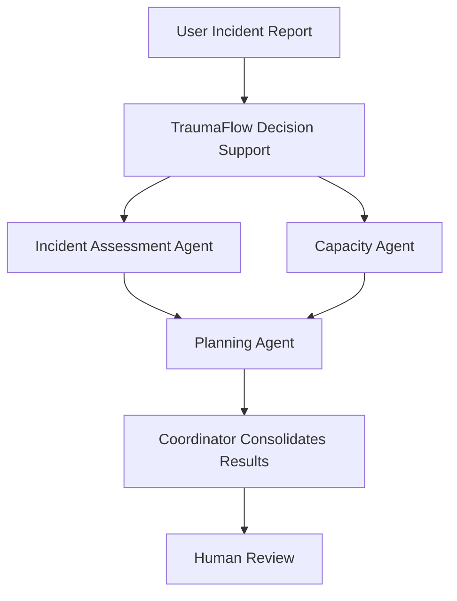

# 🚑 TraumaFlow AI
### Multi-Agent AI for Emergency Coordination and Capacity Planning

**TraumaFlow AI** is a simulation-only, multi-agent AI decision-support prototype developed for **FETCH-A-THON 3.0**. It demonstrates how specialized AI agents can assess fictional mass-casualty incidents, validate synthetic hospital capacity, and generate explainable emergency department (ED) planning options for human review.

The project uses the Fetch.ai uAgents framework, Agentverse-hosted agents, and ASI:One-powered conversational AI to explore coordinated agent workflows.

> ⚠️ **Safety Notice:** TraumaFlow AI is an educational prototype. It uses fictional incidents and synthetic hospital data. It is not connected to live hospital systems and is not validated for clinical triage, medical decisions, emergency dispatch, or real-world hospital coordination.

---

## 🎯 Problem Statement

During a mass-casualty incident (MCI), emergency coordination may require rapid organization of incident details, assessment of incoming workload, understanding of available resources, and preparation of operational options.

Information gaps and fragmented workflows can make it difficult to form a clear picture of a simulated emergency scenario.

TraumaFlow AI explores a modular approach in which specialized AI agents perform distinct tasks and contribute to a structured decision-support workflow.

## 💡 Our Solution

TraumaFlow AI consists of four hosted agents, each with a defined responsibility.

### 🤖 Multi-Agent System

#### 1. TraumaFlow Decision Support — Coordinator

**Handle:** `@traumaflow-ai`

The central conversational agent for fictional emergency coordination exercises.

- Structures incident reports and identifies missing information.
- Validates synthetic hospital capacity inputs.
- Produces explainable planning reports.
- Maintains conversational context through the Agent Chat Protocol.
- Consolidates available information for human review.

#### 2. TraumaFlow Incident Assessment

**Handle:** `@traumaflow-incident`

Assesses fictional mass-casualty incident inputs and classifies the estimated workload.

**Inputs**
- Incident type
- Estimated incoming patients
- Expected arrival window in minutes

**Workload categories**

| Category | Estimated patients |
|---|---:|
| Low | 1–5 |
| Moderate | 6–15 |
| High | 16–30 |
| Critical | More than 30 |

The agent validates inputs, explains its classification, identifies missing information, and returns a structured assessment with assumptions and a timestamp when supported.

#### 3. TraumaFlow Capacity Agent

**Handle:** `@traumaflow-capacity`

Analyzes fictional emergency department capacity using synthetic data.

**Features**
- Calculates available beds: staffed beds minus occupied beds.
- Calculates occupancy percentage: occupied beds divided by staffed beds, multiplied by 100.
- Validates nonnegative values and ensures occupied beds do not exceed staffed beds.
- Reports validation status and a timestamp.
- Flags invalid data rather than inventing values.

All capacity figures are synthetic and must not be interpreted as real hospital availability.

#### 4. TraumaFlow Planning Agent

**Handle:** `@traumaflow-planning`

Validates fictional incident and capacity reports, then proposes explainable ED planning options for human review.

**Inputs**
- Hospital capacity report, including staffed beds, occupied beds, available beds, and occupancy percentage.
- Incident assessment report, including incident type, estimated incoming patients, arrival window, and workload category.

**Outputs**
- Input summary and validation status.
- Three proposed planning options.
- Rationale and assumptions for each option.
- Missing information and limitations.
- An explicit fictional simulation disclaimer.

The agent is designed to work independently and does not claim to communicate with other agents unless that communication is implemented and verified.

---

## 🔄 Intended Workflow

The diagram illustrates the intended multi-agent architecture. End-to-end communication requires compatible message handlers, correct agent addresses, and verified request-response handling.

### Example Scenario

Consider a fictional incident with **20 estimated incoming patients over 15 minutes** and a synthetic capacity report showing **40 staffed beds and 31 occupied beds**.

The intended workflow is:

1. The Incident Assessment Agent classifies the estimated workload as **High**.
2. The Capacity Agent calculates 9 available beds and 77.5% occupancy.
3. The Planning Agent evaluates the supplied reports and proposes three planning options.
4. The coordinator presents the available results, assumptions, and missing information for human review.

This example demonstrates calculations and workflow behavior only. It does not establish real hospital capacity or determine appropriate clinical care.

---

## 🛠️ Technology Stack

| Technology | Role |
|---|---|
| Python | Agent logic and workflow implementation |
| Fetch.ai uAgents | Agent framework |
| Agentverse | Hosting and managing agents |
| Agent Chat Protocol | Structured agent messaging |
| ASI:One | Language-model-powered conversational reasoning |
| JSON | Structured input and output data |

---

## ✨ Key Features

- **Specialized agents:** Separate incident assessment, capacity analysis, planning, and coordination responsibilities.
- **Input validation:** Identifies missing, inconsistent, or invalid simulation data.
- **Transparent calculations:** Reports available beds and occupancy percentages from supplied values.
- **Explainable planning:** Provides multiple options with rationale and assumptions.
- **Uncertainty handling:** Flags missing information instead of silently inventing values.
- **Conversational interface:** Supports interactions through the Agent Chat Protocol.
- **Human oversight:** Keeps all proposed options subject to human review.
- **Simulation-first design:** Avoids claims of live hospital integration or real-world execution.

## 🏗️ Architecture and Communication

Each agent is hosted independently in Agentverse and has its own address and responsibilities.

For agents to communicate, the implementation must include:

1. Correct full agent addresses.
2. Compatible protocol definitions and message handlers.
3. Requests sent to the intended recipient.
4. Responses returned to the requesting agent.
5. Request correlation, timeouts, and error handling.
6. Tests confirming that each communication link works.

The presence of an agent in Agentverse or an active hosting status does not, by itself, demonstrate that inter-agent communication is functioning.

## 🚀 Deployment and Testing

### Agentverse Setup

1. Open each hosted TraumaFlow agent in Agentverse.
2. Review its Agent Guide and Build configuration.
3. Verify that its supported protocols match the communication implementation.
4. Copy the correct full address for each agent.
5. Configure the coordinator to use the verified specialist addresses.
6. Save and start the agents.

### Recommended Tests

- **Incident assessment:** Test all workload categories and invalid or missing inputs.
- **Capacity analysis:** Test valid values, zero staffed beds, negative values, and occupied beds exceeding staffed beds.
- **Planning:** Test consistent reports, missing reports, and contradictory inputs.
- **Coordinator:** Verify that it handles specialist replies, missing responses, and timeouts correctly.
- **Integration:** Confirm that the complete workflow returns a consolidated report without fabricating results.

---

## 🔒 Safety and Limitations

- All scenarios and capacity figures are fictional or synthetic.
- The system does not access live hospital systems.
- The system does not diagnose, prescribe, or perform clinical triage.
- It does not dispatch ambulances, transfer patients, or reserve hospital resources.
- Generated options may be incomplete or incorrect.
- The prototype requires further integration testing before its complete multi-agent workflow can be considered operational.

## 🔮 Future Enhancements

- Verified request-response communication across all four agents.
- Persistent request tracking and reliable failure recovery.
- A visual dashboard for simulation scenarios and agent outputs.
- Automated testing of inter-agent communication.
- More comprehensive synthetic datasets and scenario evaluation.
- Improved observability, validation, and report traceability.

## 🏆 Project Information

| Field | Details |
|---|---|
| Project | TraumaFlow AI |
| Event | FETCH-A-THON 3.0 |
| Domain | Agentic AI and emergency coordination simulation |
| Platform | Fetch.ai Agentverse |
| Architecture | Four specialized AI agents |
| Data | Synthetic and fictional |

## 👥 Contributors

Add your team members, GitHub usernames, and institutional affiliations here.

## 📄 License

Choose and add an appropriate open-source license before distributing the repository.

---

**TraumaFlow AI — Better coordination. Clearer information. Human-reviewed decisions.**
